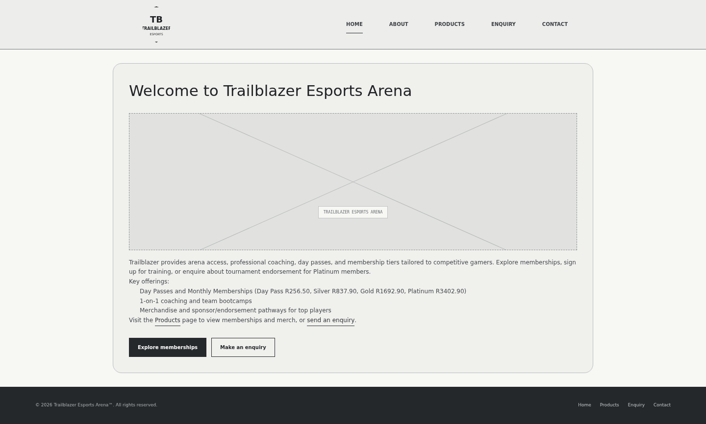
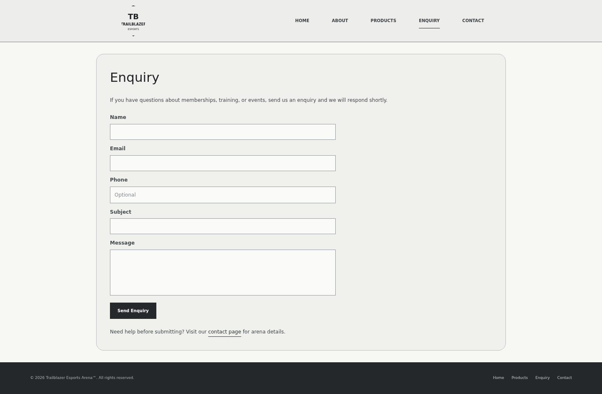
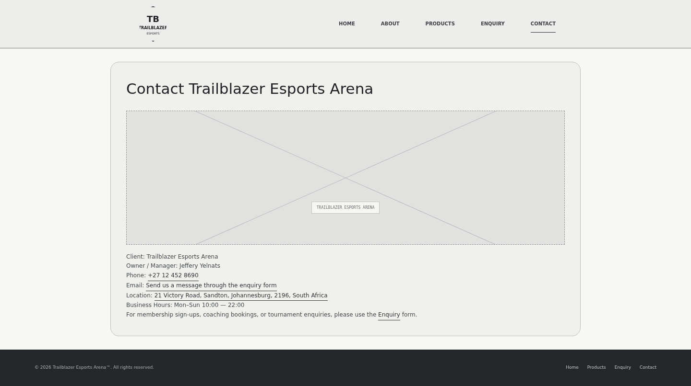
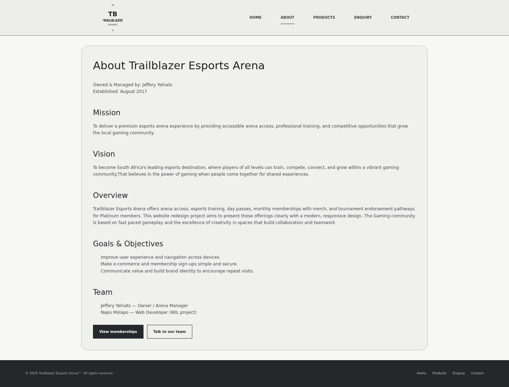
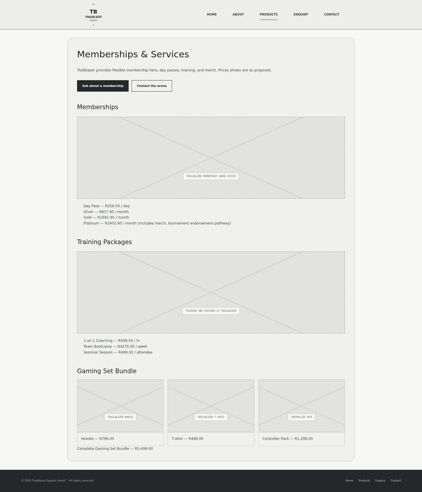

# Trailblazer Esports Arena

A responsive static website for an esports and gaming venue in Johannesburg, South Africa. The project presents the arena’s services, memberships, training packages, contact information, and enquiry process through a clean, modern front-end experience.

This project was designed as a front-end web development assignment and is built using HTML, CSS, and JavaScript. It focuses on delivering a professional online presence for a gaming venue while keeping the layout simple, approachable, and easy to navigate.

---

## Project Overview

Trailblazer Esports Arena is presented as a premium gaming venue that offers:
- arena access for gamers
- coaching and training services
- membership plans and day passes
- esports merchandise
- event and tournament support
- community-driven gaming experiences

The website includes dedicated pages for:
- Home
- About
- Products / Memberships
- Enquiry
- Contact

---

## Purpose of the Project

This project was created to:
- promote a local esports business online
- explain the services and membership packages clearly
- provide a professional digital presence
- direct users to make enquiries and contact the business
- showcase a modern and responsive front-end design
- support basic SEO and business visibility on the web

---

## Features

- responsive design for desktop and mobile devices
- user-friendly navigation across all pages
- clear information about pricing and services
- professional business branding
- enquiry form layout for customer interaction
- contact details and business information
- image-based branding and marketing content
- basic SEO metadata and page titles
- static website deployment support

## Wireframes
### Low Fidelity






### High Fidelity


## Tech Stack

This project uses:
- HTML5
- CSS3
- JavaScript
- GitHub Pages / static hosting
- PowerShell for local startup automation

### Language Composition
- HTML: 55.7%
- CSS: 28.7%
- JavaScript: 8%
- PowerShell: 7.6%

---

## Repository Structure

```text
ST10524130_Molapo_WD5020_POE_P3/
├── About.html
├── Contact.html
├── Enquiry.html
├── Products.html
├── index.html
├── README.md
├── Start-Website.ps1
├── CSS/
│   └── style.css
├── JS/
│   └── page-transition.js
├── Images_Resources/
│   ├── Arena.png
│   ├── Contact us.jpg
│   ├── ControllerPack.png
│   ├── Hoodie.png
│   ├── Membership.jpg
│   ├── Shirt.png
│   ├── Training.jpg
│   ├── TrailBlazer Logo.png
│   └── ...
├── Documents/
├── .vscode/
└── .gitignore
```

---

## Pages Included

### Home Page
The landing page introduces Trailblazer Esports Arena and highlights the main offerings, including:
- memberships
- day passes
- training packages
- coaching
- gaming community services

### About Page
The About page communicates:
- business ownership and management
- company history
- mission and vision
- goals and objectives
- team information

### Products Page
This page explains the different service packages, including:
- day passes
- Silver, Gold, and Platinum memberships
- coaching and training programs
- merchandise and gaming bundles

### Enquiry Page
This page includes a contact / enquiry form for users to send a request about:
- membership inquiries
- training sessions
- business questions
- event participation

### Contact Page
The Contact page contains:
- phone number
- business hours
- physical location
- enquiry access
- general business information

---

## Business Information

- Business Name: Trailblazer Esports Arena
- Owner / Manager: Jeffery Yelnats
- Established: August 2017
- Location: Sandton, Johannesburg, South Africa
- Phone: +27 12 452 8690
- Business Hours: Monday to Sunday, 10:00 – 22:00

---

## Setup and Local Usage

### Option 1: Open directly
Open the `index.html` file in a browser to view the website.

### Option 2: Use a local server
From the project folder, run:

```bash
python -m http.server 8000
```

Then open:

```text
http://localhost:8000
```

### Option 3: Use the PowerShell launcher
Run:

```powershell
./Start-Website.ps1
```

This can be used to open the site in a local environment depending on system configuration.

---

## Deployment

This project is designed for static hosting and can be deployed on:
- GitHub Pages
- Netlify
- Vercel
- any static web host

Typical GitHub Pages URL format:

```text
https://<username>.github.io/<repository-name>/
```

For this repository, the project can be published using a GitHub Pages setup from the repository settings.

---

## SEO and Search Visibility

This project includes SEO improvement elements such as:
- page titles
- meta descriptions
- keywords
- Open Graph metadata
- business and location details
- structured local business information

These additions help improve visibility for searches related to:
- Trailblazer Esports Arena
- esports venue Johannesburg
- gaming venue South Africa
- esports memberships
- gaming coaching and training

---

## Design and User Experience

The website focuses on:
- clean and modern design
- clear navigation
- strong brand presentation
- clear service messaging
- calls to action for enquiries and membership interest
- accessibility-friendly structure and labels

---

## Notes

This project is a static front-end website. It does not include a backend database or server-side processing. The enquiry form is currently a front-end form layout and can be connected to a backend or email service in future improvements.

---

## Future Improvements

Potential enhancements for this site include:
- backend-powered contact form submission
- email integration with a form service
- booking and reservation functionality
- online payment or product checkout
- image gallery section
- customer testimonials and reviews
- blog or news updates
- sitemap and robots.txt
- analytics tracking
- enhanced SEO optimization and local search visibility

---

## Project Summary

Trailblazer Esports Arena is a modern static website that promotes a gaming business through a strong digital presence. The project brings together branding, service showcasing, pricing information, local business details, and enquiry functionality in a single clean front-end experience.

---

## Author

J5Molapo

---

## License

This project is intended for academic and project-based use unless otherwise specified by the owner.

---

## Contact

For project-related enquiries, use the enquiry form or contact details included in the website.
